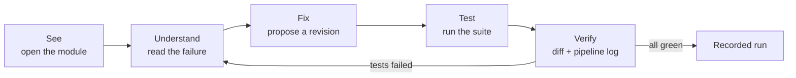

# DeVision A.I.

### Autonomous Code Repair & Verification Engine

> **See → Understand → Fix → Test → Verify**

DeVision is an interactive cockpit for a closed-loop software repair workflow. Instead of another coding chat window, it walks a broken codebase through five stages: it inspects the source, explains the failure, proposes a patch, runs the test suite, and verifies the result — with the diff, the tests, the pipeline log and the cost all on one screen.


**[Live demo](https://jocular-douhua-96704b.netlify.app/)** · [All runs](#routes)

---

## What you can do

- **Run a full repair loop** on a bundled codebase — an e-commerce guest-checkout bug — and watch each stage resolve from *pending* to *verified*.
- **Compare revisions side by side.** Every iteration is real source code with a syntax-highlighted diff against the previous one.
- **Execute the test suite.** The loop engine runs the revision's function against its cases in the browser and reports pass/fail per test.
- **Inspect the pipeline.** A CI/CD run log with per-step commands, durations, CPU, memory and cost, generated by `ci-runner.ts` for each cycle.
- **Schedule cycles.** The planner queues recurring diagnostics with start/end times, intervals, target modules and a budget ceiling.
- **Review history.** The dashboard and run timeline keep recorded cycles with stage-by-stage telemetry and diffs.

The bundled scenario finishes with **149 tests green** across two iterations, and the UI reports zero source leaving the machine — everything runs locally in the browser, with no backend, API keys or telemetry.

## Routes

| Route | Screen |
| --- | --- |
| `/` | Landing + live loop console |
| `/dashboard` | Control room: cost per cycle, CPU/memory per stage, scheduled cycles, verified-fix rate |
| `/planner` | Schedule automated repair cycles |
| `/runs` | Stage-by-stage run timeline with diffs and CI logs |

## Stack

| Layer | Choice |
| --- | --- |
| Framework | React 19 + TypeScript, TanStack Start/Router |
| Build | Vite 8 |
| UI | Tailwind CSS 4, shadcn/ui (Radix), lucide icons |
| Charts | Recharts |
| State | Lightweight stores (`run-store`, `planner-store`) |

## Quick start

```bash
git clone https://github.com/Monish03905/DEVISION-A.I.-SOFTWARE-.git
cd DEVISION-A.I.-SOFTWARE-
npm install
npm run dev        # http://localhost:8080 (see terminal)
```

| Script | What it does |
| --- | --- |
| `npm run dev` | Start the dev server |
| `npm run build` | Production build |
| `npm run preview` | Serve the build |
| `npm run lint` | ESLint |
| `npm run format` | Prettier |

## How the loop works



A preset (`src/lib/loop-engine.ts`) defines the module name, the original source, each candidate revision, and the test cases. The engine executes the selected revision against every case, computes the pass rate, and hands that to the CI runner, which produces the pipeline metrics. The stores keep completed cycles so any run can be reopened.

## Project structure

```text
src/
  routes/               index, dashboard, planner, runs (+ generated route tree)
  components/devision/  LoopConsole, CodeDiffViewer, CycleCountdown, RecordedRuns, stores
  components/ui/        shadcn/ui primitives
  lib/
    loop-engine.ts      codebase presets, revisions, test execution
    ci-runner.ts        simulated CI pipeline + resource/cost telemetry
    real-project.ts     bundled sample project metadata
    project-client.ts   project access helpers
  server.ts, start.ts   TanStack Start entry points
```

## Honest scope

- The repair loop is an interactive **demonstration** on bundled code, not an agent that edits your repository.
- Code revisions and their test cases are executed in the browser; the CI pipeline, CPU, memory and cost numbers are **simulated** by `ci-runner.ts` for a realistic readout.
- No source code, prompts or analytics are sent anywhere.

## License

No open-source license file is included; the code is published for portfolio review. Open an issue if you would like to reuse it.
